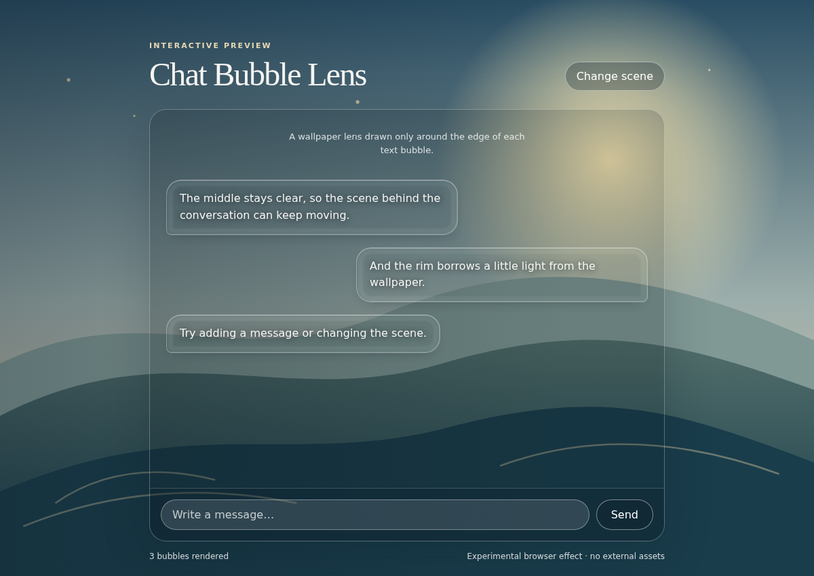
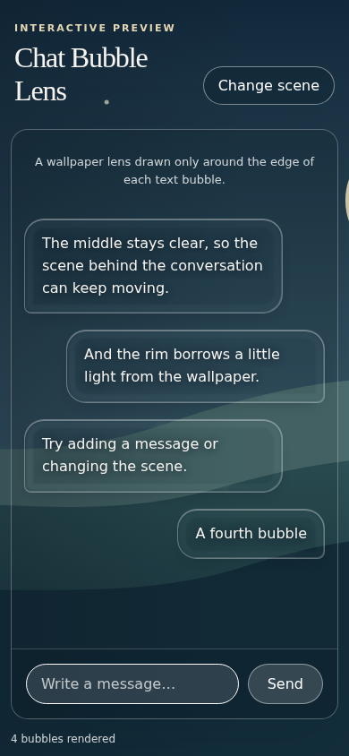

# Chat Bubble Lens

An experimental wallpaper lens for text message bubbles. The bubble centre stays transparent; a Web Worker samples the wallpaper and paints a thin refracted rim into a PNG overlay. The effect was extracted from a private chat panel so it can be improved in public.





## Try it

Serve this directory over HTTP and open `index.html` in a current Chromium browser:

```sh
python3 -m http.server 8000
# open http://127.0.0.1:8000/
```

Use **Change scene** or add a message to see the lens redraw. The wallpapers in this repository are original SVG examples; the panel's private wallpaper is not included.

## Embed it

Include `bubble-glass.js` and `bubble-lens-worker.js` in the same directory. The current adapter expects:

- a `.wall` element containing an active `` that fills its bounds with `object-fit: cover`;
- a scrollable chat container with `.msg.user` and `.msg.assistant` text bubbles;
- `body.on-wall` while the wallpaper is active;
- a CSS rule that uses `--bubble-lens` as the bubble's background image.

```js
import { mountBubbleGlass } from './bubble-glass.js';

const stop = mountBubbleGlass(document.querySelector('.chat-scroll'));
// Call stop() when the chat view is removed.
```

See `index.html`, `style.css`, and `demo.js` for the complete integration. The module watches new bubbles, scrolling, resizing, and wallpaper changes. It cleans up observers, object URLs, and its Worker when `stop()` is called.

## Current limits

- The adapter uses the selectors above and is not yet a general-purpose component.
- It needs `Worker`, `OffscreenCanvas`, `createImageBitmap`, `ResizeObserver`, and `IntersectionObserver`. Without them, the demo keeps a plain bubble style.
- The rim is rendered as a static overlay after layout settles. Rapid scrolling or animated backgrounds can briefly show an outdated sample.
- The source is a preview; visual tuning and broader browser testing remain open work.

No build step or external JavaScript packages. MIT licensed. See [LICENSE](LICENSE).
